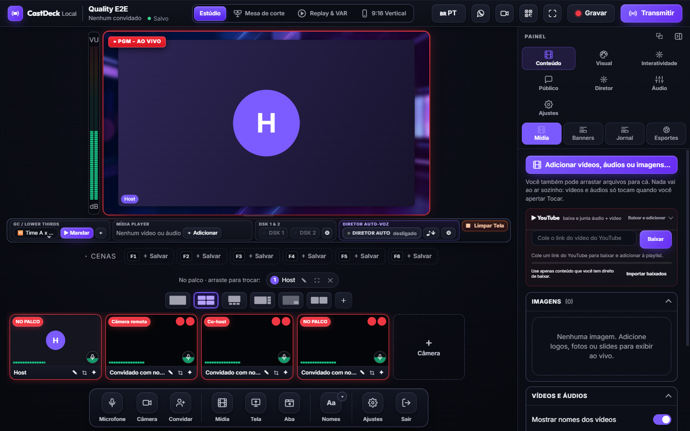

# Miguel Kallemback

**I build live production tools that run on your own device.**

Creator of **CastDeck Local** — a self-hosted live studio focused on browser-based video calls,
multistream and local recording.

[**CastDeck**](https://cast.flue.live) · [**Website**](https://cast.flue.live) ·
[**Instagram**](https://www.instagram.com/miguel_kallemback/) · [**Português**](README.pt-BR.md)

---

## 👋 Hi, I'm Miguel

I'm a Brazilian developer and live-production enthusiast. I build software for creators, churches, schools
and independent broadcasters who want professional shows **without depending on a cloud studio**.

My main project is **CastDeck Local**: open a desktop app, invite guests with a browser link, compose the
scene, record locally and stream to multiple destinations. The video call is the center of the product —
not an afterthought.

> **StreamYard alternative, with the video call first.**  
> Browser guests · mix-minus · scenes · local MP4 · multistream · 16:9 + 9:16 · open source.

## 🎬 What I'm building

### CastDeck Local

- **Guests by link** — no account, no install, Chrome/Edge on phone or desktop.
- **Real mix-minus** — guests hear the program, not their own delayed voice.
- **Scenes and layouts** — host + guests, preview/PGM, screen share, camera by QR.
- **Pro audio** — mixer, dBFS meters, buses, noise reduction and talkback.
- **Delivery** — RTMP/RTMPS/SRT multistream, local MP4 recording and simultaneous vertical 9:16.
- **Open source** — AGPL-3.0-only, with an optional commercial license.

[**See CastDeck in action →**](https://cast.flue.live)

## 🛠️ Stack I work with

## 📌 Principles

- **Local-first:** your video, audio and keys stay on your machine.
- **Video call first:** the guest experience is the product, not a checkbox.
- **Boring reliability:** local recording, predictable costs, no plan limits.
- **Open by default:** AGPL-3.0 code, documented architecture, clear licenses.
- **Honest engineering:** know the limits, measure, and say what does not work yet.

## 🌎 Elsewhere

- Website / downloads: [cast.flue.live](https://cast.flue.live)
- Instagram: [@miguel_kallemback](https://www.instagram.com/miguel_kallemback/)
- Portuguese profile: [README.pt-BR.md](README.pt-BR.md)

---

CastDeck is built by Miguel Kallemback / flue.live. “CastDeck” and the logo are trademarks; the code is
AGPL-3.0. StreamYard is a trademark of its respective owners; no affiliation.
