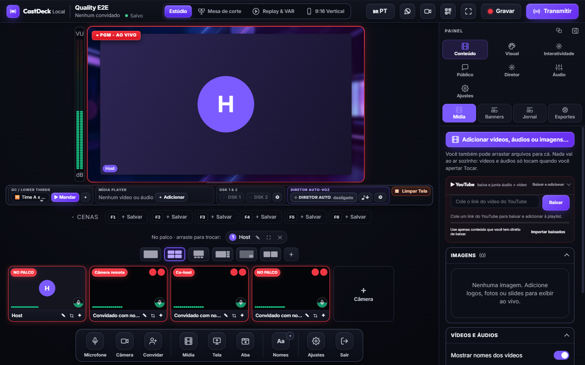

# Miguel Kallemback

**Construo ferramentas de produção ao vivo que rodam no seu próprio dispositivo.**

Criador do **CastDeck Local** — um estúdio de live local com foco em videochamada pelo navegador,
multistream e gravação no seu computador.

[**CastDeck**](https://cast.flue.live) · [**GitHub**](https://github.com/aloproducao2/castdeck-local) ·
[**Site**](https://cast.flue.live) · [**Instagram**](https://www.instagram.com/miguel_kallemback/) ·
[**English**](README.md)

---

## 👋 Olá, eu sou Miguel

Sou desenvolvedor brasileiro e apaixonado por produção ao vivo. Construo software para criadores, igrejas,
escolas e emissoras independentes que querem programas profissionais **sem depender de um estúdio na nuvem**.

Meu projeto principal é o **CastDeck Local**: abra o app no computador, convide pessoas por um link no
navegador, monte a cena, grave localmente e transmita para vários destinos. A videochamada é o centro do
produto — não um detalhe.

> **Alternativa ao StreamYard, com a videochamada em primeiro lugar.**  
> Convidados no navegador · mix-minus · cenas · MP4 local · multistream · 16:9 + 9:16 · código aberto.

## 🎬 O que estou construindo

### CastDeck Local

- **Convidados por link** — sem conta, sem instalar, Chrome/Edge no celular ou PC.
- **Mix-minus de verdade** — o convidado ouve o programa, não a própria voz atrasada.
- **Cenas e layouts** — host + convidados, prévia/PGM, compartilhar tela, câmera por QR.
- **Áudio profissional** — mixer, VU em dBFS, buses, redução de ruído e talkback.
- **Entrega** — multistream RTMP/RTMPS/SRT, gravação MP4 local e vertical 9:16 simultâneo.
- **Código aberto** — AGPL-3.0-only, com licença comercial opcional.

[**Ver o CastDeck em ação →**](https://cast.flue.live) · [**Código-fonte no GitHub →**](https://github.com/aloproducao2/castdeck-local)

## 🛠️ Tecnologias

## 📌 Princípios

- **Local-first:** vídeo, áudio e chaves ficam na sua máquina.
- **Videochamada primeiro:** a experiência do convidado é o produto, não um item de checklist.
- **Confiabilidade sem drama:** gravação local, custo previsível, sem limite de plano.
- **Aberto por padrão:** código AGPL-3.0, arquitetura documentada, licenças claras.
- **Engenharia honesta:** conhecer limites, medir e dizer o que ainda não funciona.

## 🌎 Onde me encontrar

- Site / downloads: [cast.flue.live](https://cast.flue.live)
- Instagram: [@miguel_kallemback](https://www.instagram.com/miguel_kallemback/)
- Perfil em inglês: [README.md](README.md)

---

CastDeck é feito por Miguel Kallemback / flue.live. “CastDeck” e o logotipo são marcas; o código é
AGPL-3.0. StreamYard é marca de seus respectivos donos; sem afiliação.
